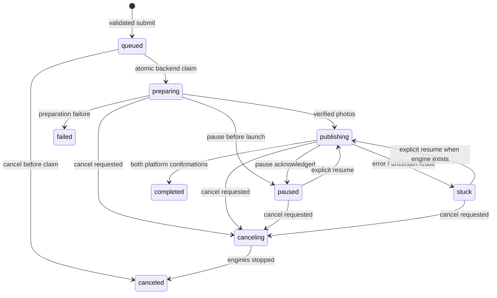

# Publication communication contract (Android)

## Responsibilities

- **Controller** collects and reviews the vehicle draft, stores account-scoped local chat history, keeps selected photos locally until explicit Publish, then uploads them and submits an immutable request. It displays server state and sends explicit controls. Closing a chat or disconnecting WebRTC does not affect queue scheduling.
- **Backend** authenticates Firebase ID tokens, checks device ownership, limits requests, validates vehicle fields and Storage metadata, creates requests idempotently, records requested controls, and atomically selects one next request only when a worker is idle. Provider credentials stay in backend secrets. The model extracts fields; deterministic schema validation decides readiness.
- **Main Pirsumoto app** performs one reserved publication. It never subscribes to or downloads the queue. An idle-only backend claim reserves one request before returning its fields and attachments, so preparation can start immediately. The worker validates attachment generations, byte lengths and SHA-256, and reports correlated progress through both platform screens. It alone acknowledges an active cancellation after automation drains.
- **WebRTC** carries screen control only. Old chat/media/publication commands are rejected, removing the duplicate Firestore/WebRTC execution paths. Authentication changes fence and close sessions; handover waits for automation to pause before admitting human input.

The canonical schema is `functions/vehicle-schema.json`. `node functions/generate-schema.js` updates the shared Dart constants consumed by both apps. Required fields include license plate, maker, model, year, mileage, price, hand, color, fuel, gearbox, current/previous ownership, registration month, vehicle condition, city, disability indication and no-test indication. At least one photo is required. Unknown government fields are collected from the user instead of filled with guesses. A plate change clears the previous vehicle and photos. Explicit `field: value` corrections work without model extraction; voice transcripts retain all spoken vehicle details.

## State and queue

Requests live at `remote_chats/{deviceId}/requests/{requestId}`. The request ID equals the chat session ID. An immutable `attemptId` follows each callback and control. An explicit new attempt may reuse a terminal chat request; a retry with the same attempt ID cannot replay it. Revisions continue increasing across attempts. New Android installations generate a unique persisted device ID. Existing saved/MDM IDs are preserved; duplicate legacy `mdm_device_01` assignments must be assigned distinct IDs before rollout. Device registration cannot overwrite another account’s owner. Changing a device ID is blocked while a publication is active.

The device parent stores only execution metadata: `activeRequestId`, `workerRunId`, and `leaseUntil`. Queue priority lives in the separate controller/backend document `remote_publication_queues/{deviceId}` (`ownerUid`, `nextRequestId`); the worker never reads or listens to it. Request revisions order UI projections and notifications. Old parent `nextRequestId` values are ignored; reselect priority in the updated controller after upgrade.

Paused, stuck and canceling requests keep the device reservation. Completing Yad2 records platform progress and retains the slot for Facebook. A terminal request cannot be revived by delayed events. Repeated submissions return the original request. Queue selection is FIFO by server enqueue time and document ID, with one optional next-request override; priority never preempts an active car. An idle worker polls `claim_publication` every ten seconds; once reserved, only that request has a live control listener. Heartbeats read the active slot and current request, never other queued cars. Dispatch has its own rate-limit bucket. A lost claim response leaves the reservation held for conservative recovery rather than risking duplicate execution.

Queue size is derived from nonarchived `queued` requests, with no persisted counter to reset. An empty queue has size zero; adding its first car gives size one and **zero publications ahead**. The controller labels this “waiting for the device · 0 publications ahead” rather than “place 1.” A queued car can remain briefly in this state until the next idle poll (up to ten seconds plus network time), or longer when the worker is offline. Active/paused/stuck/canceling cars count as real predecessors until released. Dispatch skips legacy archived queued records, including stale priority targets and entire pages of deleted entries. Archiving clears a matching priority pointer. Controller deletion never hides a request after a failed server lookup, and a queued cancellation can be archived immediately once its terminal response is received. Active cancellation still waits for engine drain.

A restarted worker recovers an expired reservation as **stuck**, never by repeating the publication. Resume cannot reconstruct an uncertain engine after a restart: inspect the sites, cancel the held request, and create a new request only when appropriate. Automatic duplicate prevention cannot make third-party website clicks transactional. After a final submit attempt, resume checks confirmation rather than clicking submit again. Unrecognized completion pages remain stuck for manual inspection. Live Android acceptance must verify the current Yad2/Facebook confirmation UI, including moderation outcomes.

## Media and history

Photos use `publication_media/{ownerUid}/{deviceId}/{requestId}/{attemptId}/{index}` in Firebase Storage. Enqueue waits for every upload and validates metadata. The worker verifies generation, size and checksum before site navigation. It deletes downloaded temporary files after a terminal outcome. The scheduled retention function preserves nonterminal request media, expires abandoned uploads after seven days, and terminal media after thirty days. Generation preconditions protect concurrent replacements. These retention intervals are code defaults to review before deployment.

SQLite databases are scoped by a hash of the authenticated account ID. Message IDs include the session ID. Recent history loads in pages of 100 and updates incrementally. The previous unscoped database is preserved; the history-import action copies only the selected, currently owned device and never replays old publication jobs. Local drafts and their photos remain local to that controller; submitted vehicle fields and status are shared through Firestore.

FCM data messages wake the controller for state changes. The Android handler checks the signed-in owner and rereads the authoritative request before displaying anything. SQLite revision receipts deduplicate foreground/background delivery. Tapping a notification opens the exact request. Android/FCM delivery is best effort; reconnecting Firestore remains the source of truth.

## Coordinated rollout — not performed by this change

1. Rotate any provider credentials previously embedded in source or distributed builds. Removing a literal does not revoke an exposed key or erase Git history. Do not store provider keys in client-readable `agent_config` documents. Review legacy/non-Android code separately; this change targets Android.
2. Configure the backend `OPENAI_API_KEY` secret for `remoteValidation`; the default extraction model is `gpt-4o-mini`, with an administrator-controlled model override. Enable Cloud Vision and grant the function service identity the appropriate API access for OCR. No provider key belongs in either Android app.
3. Review the actual Firestore and Storage rules when supplied. Rules must enforce account/device ownership, restrict device ownership changes, protect immutable request data, reserve lifecycle/lease/message writes for the worker, and restrict media access to its owner/device/request. Allow the controller to read its owned `remote_publication_queues/{deviceId}` document; queue-priority writes go through the backend. Protect notification token ownership and signaling controller identity. Deny clients access to rate-limit and maintenance documents. **Deployed security rules have not been inspected or changed.** Device-role enforcement needs a trustworthy device registration/claims mechanism; sharing only an account UID is not a worker identity boundary.
4. Deploy the new functions (`remoteValidation`, `publicationNotifications`, `publicationMediaRetention`) (including the new `claim_publication` action) and the indexes in `functions/firestore.indexes.json`, using the correct Firebase project. Ensure Storage and FCM are configured for both registered Android apps. Wait for the owner/state/enqueuedAt request index to become ready before upgrading the worker. The new worker deliberately has no collection-query fallback if the dispatch API/index is missing. Review scheduled retention before enabling it.
5. Upgrade both Android apps together. Old controller messages are deliberately not interpreted as new publication requests. Do not roll out only one app while expecting legacy publication transport to work.
6. Run an Android acceptance session on a test account: collect/correct all fields by text and voice, add photos, submit two cars, pause/resume, take remote control, cancel during upload and execution, verify that the next car waits, then check notifications and restart recovery. Verify actual site success evidence before using real listings.

## Local validation

- `node --test functions/test/*.test.js`: authorization, rate limits, idempotency, controls, priority, validation and retention.
- Worker lifecycle tests use fake Firestore, injected media and an injected launcher; they never publish real ads. They cover serial execution, cancellation drain, stale callbacks, restart recovery, corrupt attachments, competing reservations, command races, preparation pause, sign-out and positive success evidence.
- Run both Flutter analyzers, both Android debug builds, and the controller test suite.
- The existing worker `test/widget_test.dart` is still a default counter-app test: it instantiates `MyApp` without its providers and expects a nonexistent counter. It is unrelated to publication changes and fails in the full worker suite. Existing analyzer warnings also remain outside this scope.

Local tests and builds do not validate deployed rules, IAM, FCM delivery on a device, or real publication against changing third-party sites. No deployment or real publication was performed.

## Interruption investigation

Filling a new draft on a separate controller calls the authenticated backend and stores the draft in controller SQLite. It does not send a worker control or establish a WebRTC session. Controller Firestore status subscriptions are reads. The worker previously subscribed to every nonterminal request, so enqueueing or changing a second request delivered snapshots during the first automation. That collection listener and client-side queue query have been removed. New fields, images and queued requests have no notification path into the active worker. Image selection is local file/SQLite work; the only Firebase Storage upload is inside explicit submission. No Storage listeners run on the worker.

The remaining worker Firestore listeners are the exact active request (including the Yad2-to-Facebook wait) and explicit WebRTC session/candidate documents. Draft entry writes none of these. A separate local listing-history subscription, when that UI is open, watches `users/{uid}/listings`; draft entry does not write that collection either.

The regression test records every publication snapshot callback, reconciliation tick and dispatch call. After car A starts, it changes draft data, image metadata, backend chat-limit data, queued car B and queue priority: the recorded activity remains empty. A deliberate heartbeat still makes no dispatch call. Backend tests also assert that a busy dispatch reads only ownership and the active reservation, and competing dispatches return exactly one reserved car. These are local tests with fake Firestore, not measurements from the reported phone incident.

One indirect dependency existed: chat and OCR shared an account-wide rate-limit bucket. Budgets are now separated by device and workload (chat, worker, control, dispatch). Identical OCR screenshots share an in-flight/cached result (four-entry bound). Diagnostic full-tree dumps are opt-in with `--dart-define=PIRSUMOTO_AUTOMATION_TRACE=true`.

Both Android engines now serialize phase work and cancel delayed transitions/retries across pause/resume. Login probes cannot resume after their generation is invalidated. Automation channel calls explicitly require the foreground Pirsumoto window and an unlocked, interactive phone. Automation taps/scrolls wait for Android gesture completion; cancellation/rejection is surfaced as an interruption instead of false success. Explicit remote-human commands remain separate. Legacy chat-only WebRTC offers cannot trigger capture or foreground changes. Screen-capture setup drains and pauses active automation first, and disconnect resumes only a pause owned by that takeover.

This is phase-level recovery within a living engine, not an exact replay of every UI sub-action after arbitrary page changes or process death. Resume preserves the next completed-phase checkpoint; incomplete steps may require manual page correction. Final publication attempts remain protected from blind resubmission. Accessibility uses the phone's shared input/window system, so full operating-system isolation is impossible. Device logs and an Android acceptance run are still required to attribute a particular observed failure; these source findings establish risks, not proof of a particular incident.
